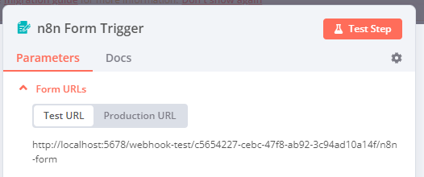

<!-- 简体中文翻译；来源 n8n-io/n8n-docs；原文版本见 upstream.json。 -->


# n8n Form Trigger（表单触发器）节点 <a href="#n8n-form-trigger-node" id="n8n-form-trigger-node"></a>

用户提交表单时，n8n Form Trigger 使用表单输入数据启动工作流，并生成可供使用的表单网页。

使用 [n8n Form](n8n-nodes-base.form.md) 节点可继续添加更多表单页面。

## 构建和测试工作流 <a href="#build-and-test-workflows" id="build-and-test-workflows"></a>

构建或测试时，使用 **Test URL**（测试 URL），便于在编辑器界面查看传入数据并调试。

有两种测试方式：

- 选择 **Execute Step**（执行步骤）。n8n 打开表单，提交后运行此节点，不运行工作流其余部分。
- 选择 **Execute Workflow**（执行工作流）。n8n 打开表单，提交后运行整个工作流。

## 生产工作流 <a href="#production-workflows" id="production-workflows"></a>

准备就绪后切换到 **Production URL**（生产 URL），再发布工作流。用户提交表单时，n8n 会自动运行工作流。

使用生产 URL 时，确保已保存并发布工作流。表单触发器传入的数据不会显示在编辑器界面中。

## 使用查询参数设置默认值 <a href="#set-default-selections-with-query-parameters" id="set-default-selections-with-query-parameters"></a>

可在 n8n Form Trigger 提供的初始 URL 中使用[查询参数](https://en.wikipedia.org/wiki/Query_string#Web_forms)，设置字段初始值。[表单每一页](n8n-nodes-base.form.md)都会收到发送到触发器 URL 的相同查询参数。


**仅适用于生产模式**

查询参数仅在生产模式下的表单中生效，测试模式不会根据查询参数填充字段值。



使用查询参数时，对包含特殊字符的字段名或值进行[百分号编码](https://en.wikipedia.org/wiki/Percent-encoding)，确保 n8n 正确使用初始值。可使用 [URL Encode/Decode](https://www.url-encode-decode.com/) 等工具完成编码。

例如，假设表单具有以下属性：

* 生产 URL：`https://my-account.n8n.cloud/form/my-form`
* 字段：
	* `name`: `Jane Doe`
	* `email`: `jane.doe@example.com`

使用查询参数和百分号编码，可通过以下 URL 将字段初始值设为上述数据：

```
https://my-account.n8n.cloud/form/my-form?email=jane.doe%40example.com&name=Jane%20Doe
```

这里，百分号编码将 @ 符号（`@`）替换为 `%40`，将空格（` `）替换为 `%20`。无论这些字段位于表单的哪一页，都会设置对应初始值。


## 节点参数 <a href="#node-parameters" id="node-parameters"></a>

主要配置字段如下：

### Authentication（身份验证） <a href="#authentication" id="authentication"></a>

- **Basic Auth**（Basic 认证）
- **n8n User Auth**（n8n 用户认证）
- **None**（无）

#### 使用 Basic 认证 <a href="#using-basic-auth" id="using-basic-auth"></a>

配置此凭据需要：

- **Username**（用户名）：访问此表单时使用的 Basic 认证用户名。
- 与该用户名对应的 **Password**（密码）。

#### 使用 n8n User Auth <a href="#using-n8n-user-auth" id="using-n8n-user-auth"></a>

只有已登录当前 n8n 实例的用户才能查看或提交表单。

* 未登录的访客打开表单时，会重定向到 n8n 登录页。
* 未登录的表单提交请求会收到 401 响应。
* n8n 默认在输出中添加提交用户的 ID、邮箱、名字和姓氏。关闭[节点选项](#node-options)中的 **Include User in Output**（输出中包含用户）可将其排除。

选择 **n8n User Auth**（n8n 用户认证）后，会显示 **Require Workflow Execute Permission**（要求工作流执行权限）开关。开启时，触发用户还必须拥有工作流所属项目的执行权限。已登录但缺少该权限的用户不能提交表单。这适用于[最终用户凭据](../../../administer/manage-credentials/end-user-credentials.md)场景，每位用户通过自己的已连接账户运行工作流。

### Form URLs（表单 URL） <a href="#form-urls" id="form-urls"></a>

Form Trigger 提供 **Test URL**（测试 URL）和 **Production URL**（生产 URL），显示在节点面板顶部。选择 **Test URL** 或 **Production URL**，切换显示的地址。



- **Test URL**（测试 URL）：工作流尚未激活时，选择 **Execute Step**（执行步骤）或 **Execute Workflow**（执行工作流）会注册测试 webhook。调用此 URL 后，n8n 在工作流中显示数据。
- **Production URL**（生产 URL）：发布工作流时注册生产 webhook。使用此 URL 时，数据不会显示在工作流界面中；仍可在 **Executions**（执行记录）标签页选择对应执行，查看生产执行的数据。

### Form Path（表单路径） <a href="#form-path" id="form-path"></a>

为表单设置自定义 URL 路径片段。


**功能可用性**

**Form Path**（表单路径）在节点版本 2.1 及更早版本中是主要参数。从节点版本 2.2 起，它变为可选项，在[节点选项](#node-options)中设置。

通过 API 或编辑 JSON 创建、更新工作流时，在 `parameters.options.path` 中设置路径片段。节点版本 2.2 及以后加载工作流时，会忽略顶层 `parameters.path`，此时表单 URL 会以 webhook ID 结尾。


### Form Title（表单标题） <a href="#form-title" id="form-title"></a>

输入表单标题。**Form Title**（表单标题）显示为网页标题和表单主 `h1` 标题。

### Form Description（表单说明） <a href="#form-description" id="form-description"></a>

输入表单说明。**Form Description**（表单说明）显示为主 `h1` 标题下方的副标题，使用 `\n` 或 `<br>` 换行。

允许及限制使用的 HTML 标签，详见 [HTML 安全与允许的标签](#html-security-and-allowed-tags)。

### Form Elements（表单元素） <a href="#form-elements" id="form-elements"></a>

创建表单问题字段，选择 **Add Form Element**（添加表单元素）新增字段。

每个字段有以下设置：

- **Field Label**（字段标签）：呈现后的表单中，显示在输入框上方的标签。
- **Field Name**（字段名称）：用于 Form Trigger 输出，可在后续节点中引用该表单字段。
- **Element Type**（元素类型）：可选 **Checkboxes**（复选框）、**Custom HTML**（自定义 HTML）、**Date**（日期）、**Dropdown**（下拉列表）、**Email**（邮箱）、**File**（文件）、**Hidden Field**（隐藏字段）、**Number**（数字）、**Password**（密码）、**Radio Buttons**（单选按钮）、**Text**（文本）或 **Textarea**（多行文本）。
    - 选择 **Checkboxes**（复选框）添加复选元素，默认不限制可选择数量。可将 **Limit Selection**（限制选择）设为 **Exact Number**（准确数量）、**Range**（范围）或 **Unlimited**（不限）来限制。
    - 选择 **Custom HTML**（自定义 HTML）插入任意 HTML。
        - 可包含链接、图片、视频等，但不能包含 `<script>`、`<style>` 或 `<input>`。更多信息，请参阅 [HTML 安全与允许的标签](#html-security-and-allowed-tags)。
        - 自定义 HTML 默认不包含在节点输出中，填写 **Element Name**（元素名称）后可将其内容包含在输出中。
    - 选择 **Date**（日期）添加日期选择器。日期格式说明，请参阅[使用 Luxon 处理日期和时间](../../../build/work-with-data/handle-special-data-types/work-with-dates-and-times.md)。
    - 选择 **Dropdown List**（下拉列表）> **Add Field Option**（添加字段选项）可添加多个选项，默认单选；开启 **Multiple Choice**（多选）允许多选。
    - 选择 **Radio Buttons**（单选按钮）添加单选元素。
    - 选择 **Hidden Field**（隐藏字段）添加不显示在表单上的元素。可通过 **Field Value**（字段值）设置默认值，或通过[查询参数](#set-default-selections-with-query-parameters)传入值。
- **Placeholder**（占位文本）：在兼容元素中显示的示例文本，支持 **Email**（邮箱）、**Number**（数字）、**Password**（密码）、**Text**（文本）和 **Textarea**（多行文本）。
- **Default value**（默认值）：在兼容元素中预填或预选的值，除 **Custom HTML**（自定义 HTML）、**File**（文件）、**Hidden Field**（隐藏字段）和 **Password**（密码）外均支持。
- **Required Field**（必填字段）：开启时，要求用户填写此字段。

### Respond When（响应时机） <a href="#respond-when" id="respond-when"></a>

选择何时响应表单提交：

- **Form Is Submitted**（表单提交时）：用户提交表单后立即响应。
- **Workflow Finishes**（工作流结束时）：工作流完成后再响应；如果执行发生错误，会告知用户表单提交存在问题。

## 节点选项 <a href="#node-options" id="node-options"></a>

选择 **Add Option**（添加选项）查看更多配置：

- **Append n8n Attribution**（附加 n8n 署名）：关闭时，隐藏表单底部的 **Form automated with n8n**（由 n8n 自动化表单）署名。
* **Button Label**（按钮标签）：表单提交按钮上显示的名称。
* **Form Path**（表单路径）：测试与生产 URL 的最后一段，替代自动生成的 UUID。从节点版本 2.2 起提供；更早版本中，**Form Path** 是主要参数，详见[表单路径](#form-path)。
* **Ignore Bots**（忽略机器人）：开启时忽略链接预览器、网络爬虫等机器人的请求。
* **Include User in Output**（输出中包含用户）：仅在 **Authentication**（身份验证）为 **n8n User Auth**（n8n 用户认证）时适用。默认开启；关闭后，从输出中排除提交用户的 ID、邮箱、名字和姓氏。
* **Use Workflow Timezone**（使用工作流时区）：开启时使用[工作流设置](../../../build/manage-workflows/configure-workflow-settings.md)中的时区，替代默认的 UTC，影响输出中的 `submittedAt` 时间戳。
* **Custom Form Styling**（自定义表单样式）：使用 CSS 覆盖公开表单界面的默认样式。字段会预先填入默认样式，便于只修改所需部分。

## 自定义 Form Trigger 行为 <a href="#customizing-form-trigger-node-behavior" id="customizing-form-trigger-node-behavior"></a>

### 使用换行排版响应文本 <a href="#format-response-text-with-line-breaks" id="format-response-text-with-line-breaks"></a>

可通过以下方式添加换行：

• 在 formSubmittedText 字段中使用 HTML，而不是纯文本。
• 发送响应前，将换行字符（`\n`）替换为 HTML 换行标签（`<br>`）。
• 需要更精细的排版控制时，使用自定义 HTML 响应页面。

### 使用身份验证限制表单访问 <a href="#restrict-form-access-with-authentication" id="restrict-form-access-with-authentication"></a>

还可使用以下方式为表单添加身份验证：

• 使用 OTP（一次性密码）字段，并通过 TOTP 节点验证令牌。
• 添加带表单身份验证的 Wait 节点，作为后续表单页面。
• 在数据库中存储密码哈希，并与提交内容比较验证。
• 需要更复杂的身份验证时，可使用 Google Forms 等外部服务。

## HTML 安全与允许的标签 <a href="#html-security-and-allowed-tags" id="html-security-and-allowed-tags"></a>

n8n Form Trigger 会自动清理 **Form Description**（表单说明）和 **Custom HTML**（自定义 HTML）元素中的 HTML，防止安全漏洞。虽然支持 HTML 排版，但部分标签和属性受到限制。

### 允许的 HTML 标签 <a href="#allowed-html-tags" id="allowed-html-tags"></a>

可用于排版的标签有：`<a>`、`<b>`、`<br>`、`<code>`、`<div>`、`<em>`、`<h1>` 到 `<h6>`、`<i>`、`<iframe>`、``、`<li>`、`<ol>`、`<p>`、`<pre>`、`<span>`、`<strong>`、`<sub>`、`<sup>`、`<table>`、`<tbody>`、`<td>`、`<tfoot>`、`<th>`、`<thead>`、`<tr>`、`<u>`、`<ul>`、`<video>` 和 `<source>`。

### 受限标签 <a href="#restricted-tags" id="restricted-tags"></a>

为安全起见，会自动移除 `<script>`、`<style>`、`<input>`、`<form>`、`<button>` 及其他可能造成 XSS 或干扰表单的危险元素。

### 属性限制 <a href="#attribute-restrictions" id="attribute-restrictions"></a>

特定标签只允许使用指定属性：

* 链接（`<a>`）：`href`、`target`、`rel`
* 图片（``）：`src`、`alt`、`width`、`height`
* 视频（`<video>`）：`controls`、`autoplay`、`loop`、`muted`、`poster`、`width`、`height`
* iframe（`<iframe>`）：`src`、`width`、`height`、`frameborder`、`allow`、`allowfullscreen`、`referrerpolicy`，会自动置于沙盒中
* 表格单元格（`<td>`、`<th>`）：`colspan`、`rowspan`、`scope`、`headers`

清理时会移除其他所有属性，仅允许 `http://` 和 `https://` URL 协议。

## 模板与示例 <a href="#templates-and-examples" id="templates-and-examples"></a>


[浏览 n8n Form Trigger 节点集成模板](https://n8n.io/integrations/n8n-form-trigger)，或[搜索所有模板](https://n8n.io/workflows/)
