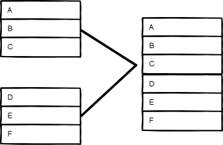
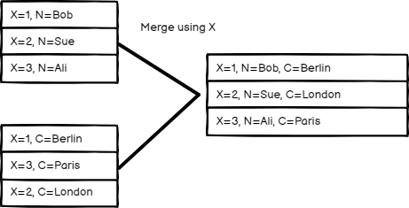
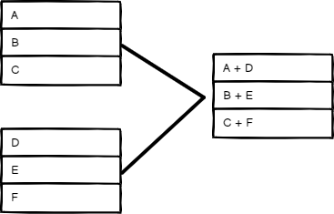
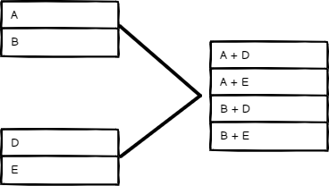

<!-- 简体中文翻译；来源 n8n-io/n8n-docs；原文版本见 upstream.json。 -->


# Merge（合并） <a href="#merge" id="merge"></a>

使用 Merge 节点，在所有数据流的数据均已可用后，合并多个数据流的数据。


**功能可用性**

Merge 节点在 n8n 0.194.0 中进行了重构。本文档对应节点的最新版本，旧版 n8n 的文档请参阅[重构前的 Merge 节点文档](https://github.com/n8n-io/n8n-docs/blob/4ff688642cc9ee7ca7d00987847bf4e4515da59d/docs/integrations/builtin/core-nodes/n8n-nodes-base.merge.md)。

从 n8n 1.49.0 起，Merge 节点支持两个以上输入，以及 **Mode > SQL Query**（模式 > SQL 查询）功能。更早版本最多支持两个输入，且没有 **Mode > SQL Query**。如果使用旧版且希望合并多个输入，请使用 [Code 节点](n8n-nodes-base.code/README.md)。


## 节点参数 <a href="#node-parameters" id="node-parameters"></a>

选择 **Mode**（模式），指定 Merge 节点如何合并不同数据流的数据：

### Append（追加） <a href="#append" id="append"></a>

保留所有输入的数据。选择 **Number of Inputs**（输入数量），依次输出各输入的数据项。节点会等待所有已连接输入执行完成。

<figure>

<figcaption>Append（追加）模式的输入和输出</figcaption>
</figure>

### Combine（组合） <a href="#combine" id="combine"></a>

组合两个输入的数据。在 **Combine By**（组合依据）中选择选项，决定如何合并输入数据。

#### Matching Fields（匹配字段） <a href="#matching-fields" id="matching-fields"></a>

按字段值比较数据项。在 **Fields to Match**（匹配字段）中输入要比较的字段。

n8n 默认保留匹配的数据项，可使用 **Output Type**（输出类型）设置更改：

* **Keep Matches**（保留匹配项）：合并匹配的数据项，类似于内连接。
* **Keep Non-Matches**（保留不匹配项）：合并不匹配的数据项。
* **Keep Everything**（保留全部）：合并匹配的数据项，同时包含不匹配的数据项，类似于外连接。
* **Enrich Input 1**（补全输入 1）：保留 Input 1 的全部数据，添加 Input 2 中匹配的数据，类似于左连接。
* **Enrich Input 2**（补全输入 2）：保留 Input 2 的全部数据，添加 Input 1 中匹配的数据，类似于右连接。

<figure>

<figcaption>按 Matching Fields（匹配字段）组合时的输入和输出</figcaption>
</figure>


#### Position（位置） <a href="#position" id="position"></a>

按顺序组合数据项。Input 1 索引 0 处的数据项与 Input 2 索引 0 处的数据项合并，依此类推。

<figure>

<figcaption>按 Position（位置）组合时的输入和输出</figcaption>
</figure>


#### All Possible Combinations（所有可能的组合） <a href="#all-possible-combinations" id="all-possible-combinations"></a>

输出所有可能的数据项组合，同时合并同名字段。

<figure>

<figcaption>按 All Possible Combinations（所有可能的组合）组合时的输入和输出</figcaption>
</figure>

#### Combine（组合）模式选项 <a href="#combine-mode-options" id="combine-mode-options"></a>

通过 **Mode > Combine**（模式 > 组合）合并数据时，可设置以下 **Options**（选项）：

* **Clash Handling**（冲突处理）：选择数据流发生冲突或包含子字段时如何合并。详情请参阅[冲突处理](#clash-handling)。
* **Fuzzy Compare**（模糊比较）：开启时，比较字段允许类型差异；关闭时不允许，默认为关闭。例如，开启后 n8n 会将 `"3"` 和 `3` 视为相同。
* **Disable Dot Notation**（禁用点表示法）：禁止在字段名称中使用 `parent.child` 访问子字段。
* **Multiple Matches**（多个匹配）：选择比较数据流时，n8n 如何处理多个匹配。
    * **Include All Matches**（包含全部匹配）：存在多个匹配时输出多个数据项，每个匹配对应一个。
    * **Include First Match Only**（仅包含第一个匹配）：每次匹配仅保留第一个数据项，丢弃其余多个匹配项。
* **Include Any Unpaired Items**（包含未配对的数据项）：选择按位置合并时保留还是丢弃未配对的数据项。默认省略没有匹配的数据项。

##### Clash Handling（冲突处理） <a href="#clash-handling" id="clash-handling"></a>



### SQL Query（SQL 查询） <a href="#sql-query" id="sql-query"></a>

编写自定义 SQL 查询来合并数据。

例如：
```sql
SELECT * FROM input1 LEFT JOIN input2 ON input1.name = input2.id
```

上游节点的数据以表的形式提供，可根据顺序在 SQL 查询中使用 input1、input2、input3 等名称引用。支持的完整 SQL 语句列表，请参阅 [AlaSQL 的 GitHub 页面](https://github.com/alasql/alasql/wiki/Supported-SQL-statements)。

#### 使用查询参数 <a href="#use-query-parameters" id="use-query-parameters"></a>

在 Merge 节点中创建 SQL 查询时，可使用 **Options**（选项）部分的 **Query Parameters**（查询参数）字段，将值加载到查询中。n8n 将查询参数值视为数据，有助于避免动态值改变 SQL 查询结构。

例如，想按姓名查找某个人。假设 `input1` 中有以下数据：

```js
[
    {
        "name": "Alex",
        "age": 21
    },
    {
        "name": "Jamie",
        "age": 33
    }
]
```

可使用 `?` 占位符编写查询：

```sql
SELECT * FROM input1 WHERE name = ? AND age > ?;
```

然后在 **Query Parameters**（查询参数）中提供要使用的值。可提供以逗号分隔的值，也可提供返回数组的表达式。本示例使用数组：

```js
{{ [ "Alex", 20 ] }}
```

#### 处理未返回任何行的查询 <a id="handle-queries-that-return-no-rows"></a>


**功能可用性**

**Empty Query Result**（空查询结果）选项从 n8n 1.95.0 起提供，适用于 Merge 节点版本 3.2。此前创建的 Merge 节点使用旧节点版本，不显示此选项，查询未返回行时始终输出 `{ "success": true }`。要使用此选项，请添加新的 Merge 节点，再将查询和选项复制过去。


查询执行成功但未返回任何行时，使用 **Options > Empty Query Result**（选项 > 空查询结果）选择节点输出：

* **Empty Result**（空结果，默认）：节点不输出任何数据项。
* **Success**（成功）：节点输出单个数据项 `{ "success": true }`。

### Choose Branch（选择分支） <a href="#choose-branch" id="choose-branch"></a>

选择要保留哪个输入。此选项始终等待两个输入的数据都可用后才执行。可选择以下 **Output**（输出）：

* **Input 1 Data**（输入 1 数据）
* **Input 2 Data**（输入 2 数据）
* **A Single, Empty Item**（单个空数据项）

节点原样输出所选输入的数据，不作修改。

## 模板与示例 <a href="#templates-and-examples" id="templates-and-examples"></a>


[浏览 Merge（合并） 集成模板](https://n8n.io/integrations/merge)，或[搜索所有模板](https://n8n.io/workflows/)

## 合并数据项数量不一致的数据流 <a href="#merging-data-streams-with-uneven-numbers-of-items" id="merging-data-streams-with-uneven-numbers-of-items"></a>

传入 Merge 节点 Input 1 的数据项优先。例如，Input 1 收到五个数据项、Input 2 收到 10 个数据项时，节点只处理五个数据项，Input 2 剩余的五个数据项不会被处理。

## If 和 Merge 节点的分支执行 <a href="#branch-execution-with-if-and-merge-nodes" id="branch-execution-with-if-and-merge-nodes"></a>




## 动手试用：分步示例 <a href="#try-it-out-a-step-by-step-example" id="try-it-out-a-step-by-step-example"></a>

使用示例输入数据创建工作流，试用 Merge 节点。

### 使用 Code 节点设置示例数据 <a href="#set-up-sample-data-using-the-code-nodes" id="set-up-sample-data-using-the-code-nodes"></a>

1. 向画布添加 Code 节点，并连接到 Start 节点。
2. 将以下 JavaScript 代码片段粘贴到 **JavaScript Code**（JavaScript 代码）字段：
```js
return [
  {
    json: {
      name: 'Stefan',
      language: 'de',
    }
  },
  {
    json: {
      name: 'Jim',
      language: 'en',
    }
  },
  {
    json: {
      name: 'Hans',
      language: 'de',
    }
  }
];
```
3. 添加第二个 Code 节点，并连接到 Start 节点。
4. 将以下 JavaScript 代码片段粘贴到 **JavaScript Code**（JavaScript 代码）字段：
```js
return [
	  {
    json: {
      greeting: 'Hello',
      language: 'en',
    }
  },
  {
    json: {
      greeting: 'Hallo',
      language: 'de',
    }
  }
];
```

### 试用不同的合并模式 <a href="#try-out-different-merge-modes" id="try-out-different-merge-modes"></a>

添加 Merge 节点。将第一个 Code 节点连接到 **Input 1**（输入 1），第二个 Code 节点连接到 **Input 2**（输入 2）。运行工作流，将数据加载到 Merge 节点。

最终工作流应如下所示：



现在尝试 **Mode**（模式）中的不同选项，观察它们对输出数据的影响。

#### Append（追加） <a href="#append" id="append"></a>

选择 **Mode**（模式）> **Append**（追加），然后选择 **Execute step**（执行步骤）。

表格视图中的输出应如下所示：

| **name** | **language** | **greeting** |
| --- | --- | --- |
| Stefan | de |  |
| Jim | en |  |
| Hans | de |  |
|   | en | Hello |
|   | de | Hallo |


#### 按 Matching Fields（匹配字段）组合 <a href="#combine-by-matching-fields" id="combine-by-matching-fields"></a>

可合并这两个数据输入，让每个人获得与其语言匹配的问候语。

1. 选择 **Mode**（模式）> **Combine**（组合）。
2. 选择 **Combine by**（组合依据）> **Matching Fields**（匹配字段）。
3. 在 **Input 1 Field**（输入 1 字段）和 **Input 2 Field**（输入 2 字段）中均输入 `language`，让 n8n 通过匹配各数据集的 `language` 字段值组合数据。
4. 选择 **Execute step**（执行步骤）。

表格视图中的输出应如下所示：


| **name** | **language** | **greeting** |
| --- | --- | --- |
| Stefan | de | Hallo |
| Jim | en | Hello  |
| Hans | de | Hallo |


#### 按 Position（位置）组合 <a href="#combine-by-position" id="combine-by-position"></a>

选择 **Mode**（模式）> **Combine**（组合），再选择 **Combine by**（组合依据）> **Position**（位置），然后选择 **Execute step**（执行步骤）。

表格视图中的输出应如下所示：

| **name** | **language** | **greeting** |
| --- | --- | --- |
| Stefan | en | Hello |
| Jim | de | Hallo  |


##### 保留未配对的数据项 <a href="#keep-unpaired-items" id="keep-unpaired-items"></a>

要保留所有数据项，选择 **Add Option**（添加选项）> **Include Any Unpaired Items**（包含未配对的数据项），并开启 **Include Any Unpaired Items**。

表格视图中的输出应如下所示：

| **name** | **language** | **greeting** |
| --- | --- | --- |
| Stefan | en | Hello |
| Jim | de | Hallo  |
| Hans | de |  |


#### 按 All Possible Combinations（所有可能的组合）组合 <a href="#combine-by-all-possible-combinations" id="combine-by-all-possible-combinations"></a>

选择 **Mode**（模式）> **Combine**（组合），再选择 **Combine by**（组合依据）> **All Possible Combinations**（所有可能的组合），然后选择 **Execute step**（执行步骤）。

表格视图中的输出应如下所示：

| **name** | **language** | **greeting** |
| --- | --- | --- |
| Stefan | en | Hello |
| Stefan | de | Hallo |
| Jim | en | Hello  |
| Jim | de | Hallo |
| Hans | en | Hello |
| Hans | de | Hallo |

