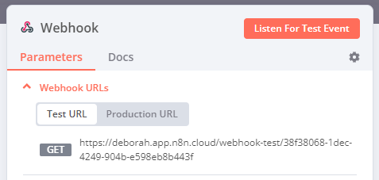

<!-- 简体中文翻译；来源 n8n-io/n8n-docs；原文版本见 upstream.json。 -->

# Webhook 

使用 Webhook 节点创建 [webhook](https://en.wikipedia.org/wiki/Webhook)，在应用或服务发生事件时接收数据。它是触发器节点，可以启动 n8n 工作流，让外部服务连接到 n8n 并运行工作流。

需要接收数据并据此运行工作流时，可使用 Webhook 节点作为触发器。它还支持返回工作流结束时生成的数据，因此可用于构建像 API 端点一样处理数据并返回结果的工作流。

即使某个服务没有专用的应用触发器节点，也可以通过 webhook 触发工作流。

## 工作流开发流程 

n8n 提供测试和生产两种 **Webhook URL**。测试 URL 包含 **Listen for test event**（监听测试事件）选项。有关构建、测试和将 Webhook 节点用于生产环境，请参阅[工作流开发](workflow-development.md)。

## 节点参数 

使用以下参数配置节点。

### Webhook URLs（Webhook 地址） 

Webhook 节点有测试和生产两个 **Webhook URLs**，显示在节点面板顶部。

选择 **Test URL**（测试 URL）或 **Production URL**（生产 URL），切换显示的地址。

<figure><figcaption>
Webhook 节点 Parameters（参数）标签页中的示例 URL
</figcaption></figure>

* **Test**（测试）：工作流尚未激活时，选择 **Listen for Test Event**（监听测试事件）或 **Execute workflow**（执行工作流），n8n 会注册测试 webhook。调用此 URL 后，n8n 会在工作流界面显示数据。
* **Production**（生产）：发布工作流时，n8n 会注册生产 webhook。使用生产 URL 时，数据不会直接显示在工作流编辑界面中。要查看生产执行的数据，选择工作流的 **Executions**（执行记录）标签页，再选择相应执行记录。

### HTTP Method（HTTP 方法） 

Webhook 节点支持标准的 [HTTP 请求方法](https://developer.mozilla.org/en-US/docs/Web/HTTP/Methods)：

* DELETE
* GET
* HEAD
* PATCH
* POST
*   PUT 

    

<strong>Webhook 最大载荷</strong>

Webhook 的最大载荷为 16MB。自托管 n8n 时，可以通过<a href="../../../../deploy/host-n8n/configure-n8n/basic-configuration/use-environment-variables/endpoints.md">端点环境变量</a> <code>N8N_PAYLOAD_SIZE_MAX</code> 修改。

### Path（路径） 

此字段默认包含随机生成的 webhook URL 路径，以避免与其他 Webhook 节点冲突。

也可以手动指定 URL 路径，包括添加路由参数。例如，使用 n8n 制作 API 原型并希望端点 URL 保持一致时，就可以这样设置。

**Path**（路径）字段支持以下格式：

* `/:variable`
* `/path/:variable`
* `/:variable/path`
* `/:variable1/path/:variable2`
* `/:variable1/:variable2`

### 支持的身份验证方法 

可以要求调用 webhook URL 的服务先通过身份验证，支持以下方法：

* Basic auth（Basic 认证）
* Header auth（请求头认证）
* JWT auth（JWT 认证）
* **n8n User Auth (OAuth2)**（n8n 用户认证）
* None（无认证）

Basic auth、Header auth 和 JWT auth 凭据类型的设置，请参阅 [Webhook 凭据](../../credentials/webhook.md)。

#### 使用 n8n User Auth (OAuth2) 

只有已登录当前 n8n 实例的用户才能调用此 webhook。调用方必须发送由此实例颁发的 OAuth2 bearer 令牌。n8n 将令牌解析为调用用户，并以该用户身份运行此次执行。在此模式下，[最终用户凭据](../../../../administer/manage-credentials/end-user-credentials.md)会解析为调用用户所连接的账户。

未携带 bearer 令牌的请求按以下规则处理：

* 来自浏览器的 GET 请求会重定向到 n8n 登录页。用户登录并授权后，n8n 将浏览器重定向回 webhook URL，并运行工作流。
* 其他请求收到 401 响应。只有 GET 请求可以重定向。

[节点选项](#node-options)中的 **OAuth2 Client**（OAuth2 客户端）控制此行为。

选择 **n8n User Auth (OAuth2)**（n8n 用户认证）后，会显示 **Require Workflow Execute Permission**（要求工作流执行权限）开关，默认开启。开启时，调用用户还必须拥有该工作流所属项目中的执行权限。已经登录但没有此工作流执行权限的用户仍不能触发工作流；携带这类用户 bearer 令牌的请求会收到 403 响应。

#### 调用使用 n8n User Auth (OAuth2) 的 webhook 

n8n 是此 webhook 的 OAuth2 授权服务器。调用方获取 bearer 令牌的方式取决于客户端类型：

* **浏览器：** 打开 webhook URL。n8n 会引导你完成登录和授权，然后运行工作流。仅适用于 GET 请求，且 **OAuth2 Client** 必须为 **Auto-Detect**（自动检测）或 **Browser (Virtual Client)**（浏览器虚拟客户端）。
* **支持 OAuth 2.1 发现的客户端：** 将 **OAuth2 Client** 设为 **Bearer Token Only**（仅 bearer 令牌），或在非浏览器请求中使用 **Auto-Detect**，然后发送不带令牌的请求。401 响应通过 `WWW-Authenticate` 请求头提供 `resource_metadata` URL。支持受保护资源元数据、动态客户端注册和 PKCE 的客户端，可以使用该 URL 完成登录及授权，无需手动配置。
* **自行编写的脚本或服务：** 针对此 n8n 实例完成 OAuth2 授权码流程：
  1. 读取 `https://<your-n8n-url>/.well-known/oauth-authorization-server` 的授权服务器元数据，其中列出了注册、授权和令牌端点。
  2. 在注册端点注册客户端，或复用此前已注册的客户端。
  3. 使用 PKCE（`S256`）将用户引导到授权端点，并将 `resource` 参数设为 webhook URL 加上 `?method=<HTTP method>`，例如 `https://<your-n8n-url>/webhook/my-path?method=POST`。用户完成登录并授权。
  4. 在令牌端点用授权码交换访问令牌和刷新令牌。
  5. 调用 webhook，并携带 `Authorization: Bearer <access token>` 请求头。

令牌绑定到颁发该令牌时对应的 Webhook 触发器。使用为其他触发器或实例 MCP 服务器颁发的令牌，会收到 401 响应。

### Respond（响应方式） 

* **Immediately**（立即响应）：Webhook 节点返回响应码和 **Workflow got started**（工作流已启动）消息。
* **When Last Node Finishes**（最后一个节点完成时）：返回响应码，以及工作流中最后执行节点的输出数据。
* **Using 'Respond to Webhook' Node**（使用 Respond to Webhook 节点）：按照 [Respond to Webhook](../n8n-nodes-base.respondtowebhook.md) 节点中的定义响应。
* **Streaming response**（流式响应）：工作流处理期间，将数据实时流式返回给用户。工作流必须包含支持流式输出的节点，例如 [AI 智能体](../../cluster-nodes/root-nodes/n8n-nodes-langchain.agent/README.md)节点。

### Response Code（响应码） 

自定义 Webhook 节点成功执行后返回的 [HTTP 响应码](https://developer.mozilla.org/en-US/docs/Web/HTTP/Status)。可以选择常见响应码，也可以设置自定义值。

### Response Data（响应数据） 

选择响应体中包含的数据：

* **All Entries**（所有数据项）：将最后一个节点的所有数据项作为数组返回。
* **First Entry JSON**（首个数据项的 JSON）：将最后一个节点首个数据项的 JSON 数据作为 JSON 对象返回。
* **First Entry Binary**（首个数据项的二进制数据）：将最后一个节点首个数据项的二进制数据作为二进制文件返回。
* **No Response Body**（无响应体）：返回时不包含响应体。

仅适用于 **Respond > When Last Node Finishes**（响应方式 > 最后一个节点完成时）。

## 节点选项 

选择 **Add Option**（添加选项）查看更多配置。可用选项取决于节点参数，具体适用条件见下表。

* **Allowed Origins (CORS)**（允许的来源）：设置允许的跨域域名，以逗号分隔允许进行跨域非预检请求的 URL。默认 `*` 表示允许所有来源。
* **Binary Property**（二进制属性）：开启后，Webhook 节点可以接收图片、音频等二进制数据。输入用于写入所接收文件数据的二进制属性名称。
* **Ignore Bots**（忽略机器人）：忽略链接预览器、网络爬虫等机器人的请求。
* **IP(s) Allowlist**（IP 允许列表）：限制可调用 Webhook 触发器 URL 的来源，以逗号分隔允许的 IP 地址。列表外的 IP 会收到 403 错误。留空时，允许所有 IP 地址调用。
* **No Response Body**（无响应体）：开启后，阻止 n8n 发送响应体。
* **OAuth2 Client**（OAuth2 客户端）：在 **Authentication**（身份验证）为 **n8n User Auth (OAuth2)** 时，决定如何处理未携带 bearer 令牌的请求。**Auto-Detect**（自动检测，默认）将浏览器导航请求重定向到 n8n 登录页，其他请求必须提供 bearer 令牌。**Bearer Token Only**（仅 bearer 令牌）始终要求令牌，绝不重定向。**Browser (Virtual Client)**（浏览器虚拟客户端）会将未携带令牌的 GET 请求引导到登录页。只有 GET 请求可以重定向。版本低于 2.2 的 Webhook 节点，在手动设置此选项前仍使用 **Bearer Token Only** 行为。
* **Only Run If**（仅在满足条件时运行）：针对传入请求求值的表达式，只有返回 `true` 时才运行工作流。使用 `$json` 访问请求，结构为 `{ body, headers, params, query }`，例如 `{{ $json.body.campaign_id === 'user-research-invite' }}`。条件不匹配时，返回 200 响应，不创建执行记录。如果表达式求值失败，n8n 会记录警告并放行请求，而不是阻止请求。此判断在 IP 允许列表和身份验证之后执行，同时适用于测试和生产 webhook URL。
* **Raw Body**（原始请求体）：指定 Webhook 节点按原始格式接收 JSON、XML 等数据。
* **Response Content-Type**（响应内容类型）：选择 webhook 响应体的格式。
* **Response Data**（响应数据）：在响应中发送自定义数据。
* **Response Headers**（响应头）：在 Webhook 响应中发送额外响应头。更多信息，请参阅 [MDN Web Docs | 响应头](https://developer.mozilla.org/en-US/docs/Glossary/Response_header)。
* **Property Name**（属性名称）：n8n 默认返回所有可用数据。可指定某个 JSON 键，让 n8n 仅返回该键的值。

| 选项 | 所需的节点配置 |
| ---------------------- | ------------------------------------------------------------------------------------- |
| Allowed Origins (CORS)（允许的来源） | 任意配置 |
| Binary Property（二进制属性） | 
满足任一条件： HTTP Method > POST HTTP Method > PATCH HTTP Method > PUT
 |
| Ignore Bots（忽略机器人） | 任意配置 |
| IP(s) Allowlist（IP 允许列表） | 任意配置 |
| Only Run If（仅在满足条件时运行） | 任意配置 |
| Property Name（属性名称） | 
同时满足： Respond > When Last Node Finishes Response Data > First Entry JSON
 |
| No Response Body（无响应体） | Respond > Immediately |
| OAuth2 Client（OAuth2 客户端） | Authentication > n8n User Auth (OAuth2) |
| Raw Body（原始请求体） | 任意配置 |
| Response Code（响应码） | 除 Respond > Using 'Respond to Webhook' Node 外的任意配置 |
| Response Content-Type（响应内容类型） | 
同时满足： Respond > When Last Node Finishes Response Data > First Entry JSON
 |
| Response Data（响应数据） | Respond > Immediately |
| Response Headers（响应头） | 任意配置 |

## n8n 如何保护 HTML 响应 


**功能可用性**

将 webhook 的 HTML 响应自动包装在 `<iframe>` 标签中的功能，自 n8n 1.103.0 起提供。


从 n8n 1.103.0 起，n8n 会自动将 webhook 的 HTML 响应包装在 `<iframe>` 标签中，以保护实例用户。

这会产生以下影响：

* HTML 在沙盒 iframe 中呈现，而不是直接在父文档中呈现。
* 尝试访问顶层窗口或本地存储的 JavaScript 代码会失败。
* 沙盒 iframe 中无法使用身份验证请求头，例如 Basic 认证。需要采用其他方式，例如在 HTML 中嵌入短期有效的访问令牌。
* 相对 URL（例如 `<form action="/">`）无法使用，请改用绝对 URL。

## 模板与示例 

[浏览 n8n-nodes-base.webhook 集成模板](https://n8n.io/integrations/webhook)，或[搜索所有模板](https://n8n.io/workflows/)

## 常见问答 

### 如何通过外部事件触发工作流？ 

将 Webhook 节点添加为触发器。它会创建一个 [webhook URL](#webhook-urls)，在应用或服务发生事件时接收数据，再使用这些数据启动工作流，适合没有专用应用触发器节点的服务。

### 测试与生产 webhook URL 有什么区别？ 

节点提供两个 [webhook URL](#webhook-urls)。选择 **Listen for Test Event**（监听测试事件）后，可使用 **test**（测试）URL，并在编辑器中查看传入数据。发布工作流时注册 **production**（生产）URL，数据不会显示在编辑器中。可在工作流的 **Executions**（执行记录）标签页查看生产执行。

### 如何保护 webhook？ 

在[支持的身份验证方法](#supported-authentication-methods)中要求认证。调用 URL 的服务可使用 Basic auth、Header auth 或 JWT auth；也可使用 n8n User Auth (OAuth2)，仅允许当前 n8n 实例的已登录用户调用。还可通过 **IP(s) Allowlist**（IP 允许列表）限制调用来源。请参阅 [Webhook 凭据](../../credentials/webhook.md)。

## 常见问题 

常见疑问或问题及建议的解决方法，请参阅[常见问题](common-issues.md)。
