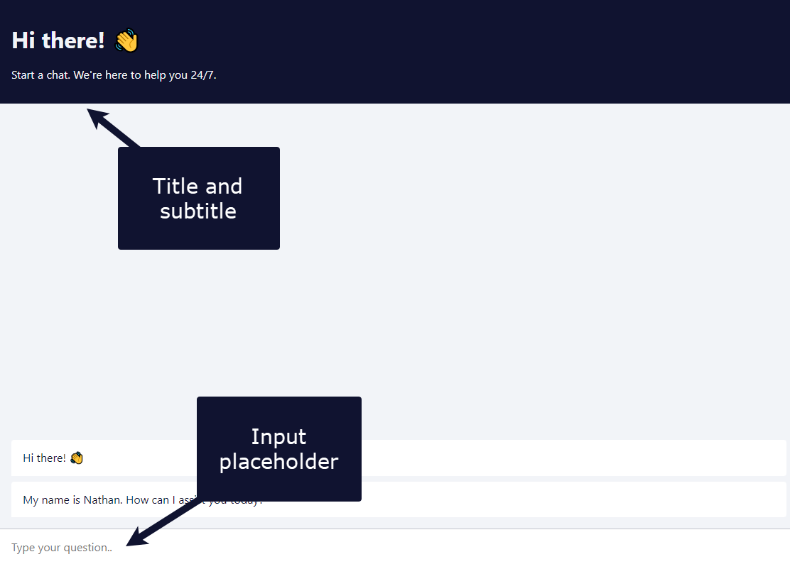
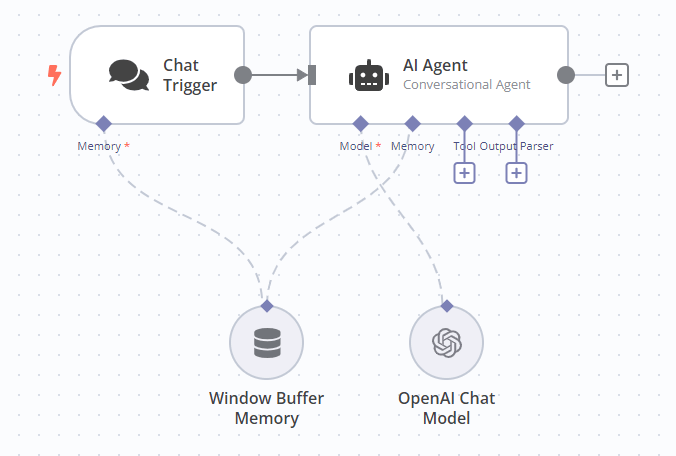
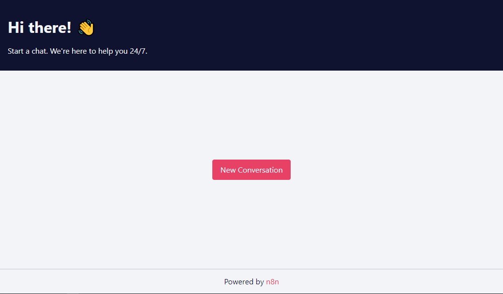

<!-- 简体中文翻译；来源 n8n-io/n8n-docs；原文版本见 upstream.json。 -->

# Chat Trigger（聊天触发器） 

为聊天机器人及其他聊天界面构建 AI 工作流时，使用 Chat Trigger 节点。可配置用户如何访问聊天，选择 n8n 提供的界面或自己的界面，并可添加身份验证。

必须连接智能体或链的[根节点](../../cluster-nodes/root-nodes/README.md)。


**工作流执行用量**

发送给 Chat Trigger 的每条消息都会执行工作流。因此，一段对话中用户发送 10 条消息，就会消耗执行额度中的 10 次执行。具体额度请查看订阅方案。



**功能可用性**

Chat Trigger 节点自 n8n 1.24.0 起提供，替代 Manual Chat Trigger 节点。


## 节点参数 

### Make Chat Publicly Available（公开聊天） 

开启时公开聊天，关闭时只能通过手动聊天界面使用。

构建工作流期间保持关闭。准备好发布工作流并允许用户访问聊天时，再开启。

#### Mode（模式） 

选择用户访问聊天的方式：

* **Hosted Chat**（托管聊天）：使用 n8n 托管的聊天界面。适合大多数用户，可通过[节点选项](./README.md#node-options)配置界面，无需其他设置。
* **Embedded Chat**（嵌入聊天）：需要创建自己的聊天界面，可使用 n8n 的[聊天组件](https://www.npmjs.com/package/@n8n/chat)或自行构建。界面必须调用节点 **Chat URL**（聊天 URL）中显示的 webhook URL。

#### Authentication（身份验证） 

选择是否以及如何限制聊天访问：

* **None**（无）：不使用身份验证，任何人都可使用聊天。
* **Basic Auth**（Basic 认证）：聊天使用 Basic 身份验证。
  * 选择或创建包含用户名和密码的 **Credential for Basic Auth**（Basic 认证凭据）。所有用户必须使用同一组用户名和密码。
* **n8n User Auth**（n8n 用户认证）：仅已登录 n8n 账户的用户可使用聊天。

选择 **n8n User Auth**（n8n 用户认证）后，会显示 **Require Workflow Execute Permission**（要求工作流执行权限）开关。开启时，触发用户还必须拥有工作流所属项目中的执行权限。已登录但缺少该工作流执行权限的用户仍不能使用聊天。这适用于[最终用户凭据](../../../../administer/manage-credentials/end-user-credentials.md)场景，每位用户通过自己的已连接账户运行工作流。

#### Initial Message(s)（初始消息） 

此参数仅适用于 **Hosted Chat**（托管聊天），用于设置用户打开页面时界面显示的消息。

### Make Available in n8n Chat（在 n8n Chat 中提供） 

选择是否将智能体提供给 Chat Hub 使用。

#### Agent Name（智能体名称） 

智能体在 Chat Hub 中的名称。

#### Agent description（智能体说明） 

智能体在 Chat Hub 中的说明。

## 节点选项 

可用选项取决于聊天模式。

### 托管聊天选项 

#### Allowed Origin (CORS)（允许的来源） 

设置可访问聊天 URL 的来源，输入以逗号分隔、允许跨域非预检请求的 URL 列表。

使用 `*`（默认）允许所有来源。

#### Input Placeholder、Title 和 Subtitle（输入占位文本、标题和副标题） 

输入聊天界面中这些元素显示的文本。

查看截图

#### Load Previous Session（加载先前会话） 

选择是否加载上一次聊天会话中的消息。

选择 **Off**（关闭）以外的选项时，必须将 Chat Trigger 和所用 Agent 连接到记忆子节点。将 **Load Previous Session**（加载先前会话）设为 **From Memory**（从记忆加载）后，会显示 Chat Trigger 的记忆连接口。n8n 建议两者连接同一个记忆子节点，确保使用同一份会话数据。

查看截图

#### Response Mode（响应模式） 

工作流在处理聊天的智能体或链节点之后还有其他步骤时，使用此选项，可选：

* **When Last Node Finishes**（最后一个节点完成时）：Chat Trigger 返回响应码及工作流中最后执行节点的输出数据。
* **Using Response Nodes**（使用响应节点）：按 [Chat](../n8n-nodes-langchain.chat.md) 或 [Respond to Webhook](../n8n-nodes-base.respondtowebhook.md) 节点中的定义响应。此时 Chat Trigger 只显示这些节点定义的消息，不输出工作流中最后执行节点的数据。此模式从 Chat Trigger 节点版本 1.2 起替代原 Using Respond to Webhook Node（使用 Respond to Webhook 节点）模式。

* **Streaming response**（流式响应）：工作流处理期间向用户实时流式返回数据，要求工作流中有支持流式输出的节点，例如 [AI Agent](../../cluster-nodes/root-nodes/n8n-nodes-langchain.agent/README.md) 节点。

#### Require Button Click to Start Chat（点击按钮后开始聊天） 

开启时，在聊天界面显示 **New Conversation**（新对话）按钮；关闭时不显示。

查看截图

### 嵌入聊天选项 

#### Allowed Origin (CORS)（允许的来源） 

设置可访问聊天 URL 的来源，输入以逗号分隔、允许跨域非预检请求的 URL 列表。

使用 `*`（默认）允许所有来源。

#### Load Previous Session（加载先前会话） 

选择是否加载上一次聊天会话中的消息。

选择 **Off**（关闭）以外的选项时，必须将 Chat Trigger 和所用 Agent 连接到记忆子节点。将 **Load Previous Session**（加载先前会话）设为 **From Memory**（从记忆加载）后，会显示 Chat Trigger 的记忆连接口。n8n 建议两者连接同一个记忆子节点，确保使用同一份会话数据。

查看截图

#### Response Mode（响应模式） 

工作流在处理聊天的智能体或链节点之后还有其他步骤时，使用此选项，可选：

* **When Last Node Finishes**（最后一个节点完成时）：Chat Trigger 返回响应码及工作流中最后执行节点的输出数据。
* **Using Response Nodes**（使用响应节点）：按 [Respond to Webhook](../n8n-nodes-base.respondtowebhook.md) 节点的定义响应。原文还列出了 [Chat](../n8n-nodes-langchain.chat.md) 节点，但该节点文档明确不支持 Embedded（嵌入）模式，因此嵌入聊天应使用 Respond to Webhook。此响应模式只显示响应节点定义的消息，不输出工作流中最后执行节点的数据。从 Chat Trigger 节点版本 1.2 起，此模式替代原 Using Respond to Webhook Node（使用 Respond to Webhook 节点）模式。

* **Streaming response**（流式响应）：工作流处理期间向用户实时流式返回数据，要求启用支持流式输出的节点。

## 模板与示例 

[浏览 Chat Trigger 集成模板](https://n8n.io/integrations/chat-trigger)，或[搜索所有模板](https://n8n.io/workflows/)

## 相关资源 



## 手动设置聊天响应 

不想将 Agent 或 Chain 节点的输出直接发给用户，而需要先修改或处理输出，再返回给用户时，就需要手动设置聊天响应。

基本工作流中，Agent 和 Chain 节点输出名为 `output` 或 `text` 的参数，Chat Trigger 将其值作为聊天响应发送给用户。

要手动创建响应，必须创建名为 `text` 或 `output` 的参数。使用其他参数名时，Chat Trigger 会将整个对象作为响应，而不只是其中的值。


**Chat 节点**

使用 [Chat](../n8n-nodes-langchain.chat.md) 节点手动创建响应时，必须将 Chat Trigger 响应模式设为 Using Response Nodes（使用响应节点）。


## 常见问答 

### 如何将聊天界面连接到 n8n 工作流？ 

将 Chat Trigger 添加为工作流触发器，再连接智能体或链的根节点。用户每发送一条消息都会运行工作流，后端逻辑因此能够处理每条消息。

### 如何公开聊天或嵌入自己的网站？ 

开启[公开聊天](#make-chat-publicly-available)，然后选择 **Mode**（模式）。**Hosted Chat**（托管聊天）使用 n8n 托管界面，无需额外设置；**Embedded Chat**（嵌入聊天）可使用 n8n 的[聊天组件](https://www.npmjs.com/package/@n8n/chat)或自己的界面，并调用节点显示的 **Chat URL**（聊天 URL）webhook。

### 如何通过工作流设置聊天机器人响应？ 

基本工作流中，Chat Trigger 将 Agent 或 Chain 节点的 `output` 或 `text` 值发送给用户。要自定义响应，创建名为 `text` 或 `output` 的参数，详见[手动设置聊天响应](#set-the-chat-response-manually)。使用 Chat 节点时，将 **Response Mode**（响应模式）设为 **Using Response Nodes**（使用响应节点）。

## 常见问题 

常见疑问或问题及建议的解决方法，请参阅[常见问题](common-issues.md)。
