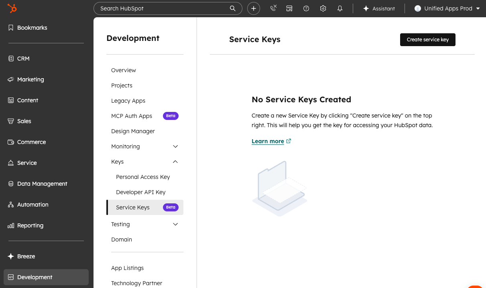
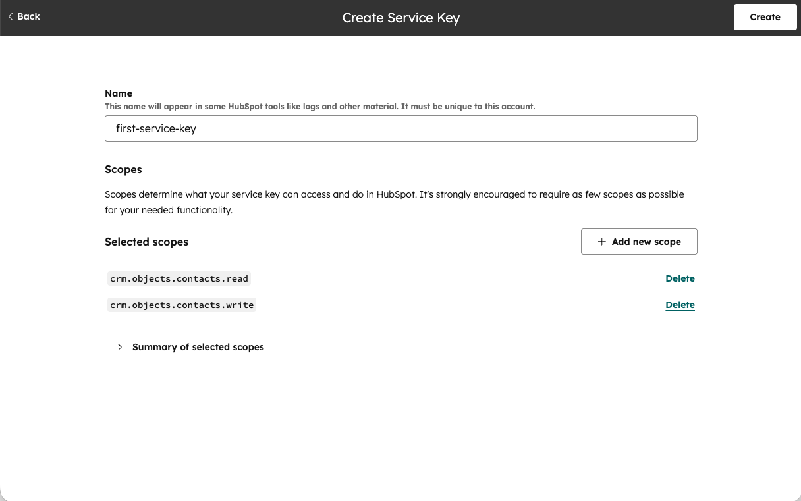

<!-- 简体中文翻译；来源 n8n-io/n8n-docs；原文版本见 upstream.json。 -->

# HubSpot 凭据 

这些凭据可用于以下节点的身份验证：

- [HubSpot](../app-nodes/n8n-nodes-base.hubspot.md)
- [HubSpot Trigger（触发器）](../trigger-nodes/n8n-nodes-base.hubspottrigger.md)

## 支持的身份验证方式 

- Service key（服务密钥，推荐）：用于 [HubSpot](../app-nodes/n8n-nodes-base.hubspot.md) 节点。
- Developer API key（开发者 API 密钥）：用于 [HubSpot Trigger（触发器）](../trigger-nodes/n8n-nodes-base.hubspottrigger.md)节点。
- OAuth2：用于 [HubSpot](../app-nodes/n8n-nodes-base.hubspot.md) 节点。


**API 密钥已弃用**

HubSpot 已弃用普通 **API Key**（API 密钥）身份验证方式。n8n 中仍显示此选项，但应改用上述方式。如果现有集成仍使用此 API 密钥方式，请参阅 HubSpot 的[将 API 密钥集成迁移到私有应用](https://web.archive.org/web/20240106022147/https://developers.hubspot.com/docs/api/migrate-an-api-key-integration-to-a-private-app)指南，设置服务密钥。



**通过界面创建的私有应用现已归为旧版**

HubSpot 已将通过界面创建的私有应用归为旧版。如果使用此类应用的私有应用访问令牌，HubSpot 建议改用服务密钥。更多信息，请参阅 [HubSpot 私有应用文档](https://developers.hubspot.com/docs/apps/legacy-apps/private-apps/overview)。


## 相关资源 

有关该服务的更多信息，请参阅 [HubSpot API 文档](https://developers.hubspot.com/docs/api/overview)。[HubSpot Trigger（触发器）](../trigger-nodes/n8n-nodes-base.hubspottrigger.md)节点使用 Webhooks API，其更多信息请参阅 [HubSpot Webhooks API 文档](https://developers.hubspot.com/docs/api-reference/webhooks-webhooks-v3/guide)。

## 使用服务密钥 

配置此凭据需要具有超级管理员权限或 Developer tools access（开发者工具访问）权限的 [HubSpot](https://www.hubspot.com/) 账户，以及：

- **Service Key**（服务密钥）

生成服务密钥的步骤如下：

1. 在 HubSpot 账户中进入 **Development**（开发）> **Keys**（密钥）> **Service Keys**（服务密钥）。也可从 **Settings**（设置）> **Account Management**（账户管理）> **Integrations**（集成）> **Service Keys**（服务密钥）找到。

    

2. 选择 **Create service key**（创建服务密钥）。

    

3. 输入有描述性的密钥 **Name**（名称）。
4. 选择 **Add new scope**（添加新作用域），选取集成所需权限。建议作用域列表，请参阅 [HubSpot 节点所需作用域](#required-scopes-for-hubspot-node)。
5. 选择 **Update**（更新），确认作用域选择。
6. 选择 **Create**（创建），再在对话框中确认。
7. 点击新服务密钥的名称，进入详情页，选择 **Show**（显示）查看密钥。
8. 使用复制按钮复制密钥值，粘贴到 n8n 凭据的 **App Token**（应用令牌）。


**服务密钥处于公开测试阶段**

服务密钥目前处于公开测试阶段，可能发生变化。最新信息，请参阅 [HubSpot 服务密钥文档](https://developers.hubspot.com/docs/apps/developer-platform/build-apps/authentication/account-service-keys)。


## 使用开发者 API 密钥 

配置此凭据需要一个 [HubSpot developer](https://developers.hubspot.com/)（开发者）账户，以及：

- **Client ID**（客户端 ID）：创建公开应用后生成。
- **Client Secret**（客户端密钥）：创建公开应用后生成。
- **Developer API Key**（开发者 API 密钥）：从 Developer Apps（开发者应用）控制台生成。
- **App ID**（应用 ID）：创建公开应用后生成。

创建公开应用并设置凭据的步骤如下：

1. 登录 [HubSpot 应用开发者账户](https://developers.hubspot.com/)。
2. 从主导航栏选择 **Apps**（应用）。
3. 选择 **Get HubSpot API key**（获取 HubSpot API 密钥），可能还需要选择 **Show key**（显示密钥）。
4. 复制密钥，填入 n8n 的 **Developer API Key**（开发者 API 密钥）。
3. 仍在 HubSpot 的 **Apps**（应用）页面，选择 **Create app**（创建应用）。
4. 在 **App Info**（应用信息）选项卡中，添加 **App name**（应用名称）、**Description**（描述）、**Logo**（标志）及希望提供的支持联系信息。接触到应用的用户均可看到这些内容。
5. 打开 **Auth**（身份验证）选项卡。
6. 复制 **App ID**（应用 ID），填入 n8n。
6. 复制 **Client ID**（客户端 ID），填入 n8n。
7. 复制 **Client Secret**（客户端密钥），填入 n8n。
8. 在 **Scopes**（作用域）部分，选择 **Add new scope**（添加新作用域）。
9. 将 [HubSpot Trigger 节点所需作用域](#required-scopes-for-hubspot-trigger-node)中列出的全部作用域添加到应用。
10. 选择 **Update**（更新）。
11. 从 n8n 复制 **OAuth Redirect URL**（OAuth 重定向 URL），填入 HubSpot 应用的 **Redirect URL**（重定向 URL）。
12. 选择 **Create app**（创建应用），完成 HubSpot 应用创建。

 更详细的说明，请参阅 [HubSpot 公开应用文档](https://developers.hubspot.com/docs/apps/legacy-apps/public-apps/overview)。

### HubSpot Trigger 节点所需作用域 

如果创建的应用用于 [HubSpot Trigger（触发器）](../trigger-nodes/n8n-nodes-base.hubspottrigger.md)节点，n8n 建议先使用以下作用域：

| **类别** | **对象** | **权限** | **作用域名称** |
| --- | --- | --- | --- |
| 不适用 | 不适用 | 不适用 | `oauth` |
| CRM | Companies（公司） | 读取 | `crm.objects.companies.read` |
| CRM | Companies schemas（公司架构） | 读取 | `crm.schemas.companies.read` |
| CRM | Contacts（联系人） | 读取 | `crm.objects.contacts.read` |
| CRM | Contacts schemas（联系人架构） | 读取 | `crm.schemas.contacts.read` |
| CRM | Deals（交易） | 读取 | `crm.objects.deals.read` |
| CRM | Deals schemas（交易架构） | 读取 | `crm.schemas.deals.read` |

## 使用 OAuth2 



如果[自托管](../../../deploy/host-n8n/README.md) n8n，需要通过创建新的公开应用，从头配置 OAuth2：

1. 登录 [HubSpot 应用开发者账户](https://developers.hubspot.com/)。
2. 从主导航栏选择 **Apps**（应用）。
3. 选择 **Create app**（创建应用）。
4. 在 **App Info**（应用信息）选项卡中，添加 **App name**（应用名称）、**Description**（描述）、**Logo**（标志）及希望提供的支持联系信息。接触到应用的用户均可看到这些内容。
5. 打开 **Auth**（身份验证）选项卡。
6. 复制 **App ID**（应用 ID），填入 n8n。
6. 复制 **Client ID**（客户端 ID），填入 n8n。
7. 复制 **Client Secret**（客户端密钥），填入 n8n。
8. 在 **Scopes**（作用域）部分，选择 **Add new scope**（添加新作用域）。
9. 将 [HubSpot 节点所需作用域](#required-scopes-for-hubspot-node)中列出的全部作用域添加到应用。
10. 选择 **Update**（更新）。
11. 从 n8n 复制 **OAuth Redirect URL**（OAuth 重定向 URL），填入 HubSpot 应用的 **Redirect URL**（重定向 URL）。
12. 选择 **Create app**（创建应用），完成 HubSpot 应用创建。

更详细的说明，请参阅 [HubSpot 公开应用文档](https://developers.hubspot.com/docs/apps/legacy-apps/public-apps/overview)。如需进一步了解 OAuth Web 流程，请参阅 [HubSpot 使用 OAuth 文档](https://developers.hubspot.com/docs/apps/legacy-apps/authentication/working-with-oauth)。

## HubSpot 节点所需作用域 

如果创建的应用用于 [HubSpot](../app-nodes/n8n-nodes-base.hubspot.md) 节点，n8n 建议先使用以下作用域：

| **类别** | **对象** | **权限** | **作用域名称** |
| --- | --- | --- | --- |
| 不适用 | 不适用 | 不适用 | `oauth` |
| 不适用 | 不适用 | 不适用 | `forms` |
| 不适用 | 不适用 | 不适用 | `tickets` |
| CRM | Companies（公司） | 读取   写入 | `crm.objects.companies.read`   `crm.objects.companies.write` |
| CRM | Companies schemas（公司架构） | 读取 | `crm.schemas.companies.read` |
| CRM | Contacts schemas（联系人架构） | 读取 | `crm.schemas.contacts.read` |
| CRM | Contacts（联系人） | 读取   写入 | `crm.objects.contacts.read`   `crm.objects.contacts.write` |
| CRM | Deals（交易） | 读取   写入 | `crm.objects.deals.read`   `crm.objects.deals.write` |
| CRM | Deals schemas（交易架构） | 读取 | `crm.schemas.deals.read` |
| CRM | Owners（所有者） | 读取 | `crm.objects.owners.read` |
| CRM | Lists（列表） | 写入 | `crm.lists.write` |

