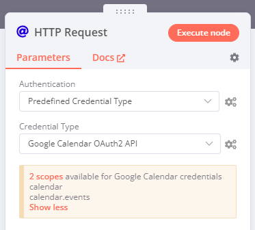

<!-- 简体中文翻译；来源 n8n-io/n8n-docs；原文版本见 upstream.json。 -->

# 自定义 API 操作 



## 预定义凭据类型 

预定义凭据类型是 n8n 中已存在的凭据类型。在 HTTP Request 和 GraphQL 节点中，可以用预定义凭据类型替代通用凭据。

例如，先为 Asana 节点创建 Asana 凭据。以后需要通过 Asana API 执行该节点尚未支持的操作时，可以在 HTTP Request 节点中使用已有的 Asana 凭据，无需再次设置身份验证。

### 使用预定义凭据类型 



### 凭据作用域 

部分现有凭据类型具有特定作用域，即它们可以访问的 API 范围。选择凭据类型时，n8n 会提示此限制。

例如，按照[使用预定义凭据类型](#using-predefined-credential-types)的步骤操作，并将 **Credential Type**（凭据类型）选为 **Google Calendar OAuth2 API**。n8n 会显示提示框，列出此凭据类型涵盖的两个作用域：`calendar` 和 `calendar.events`。

