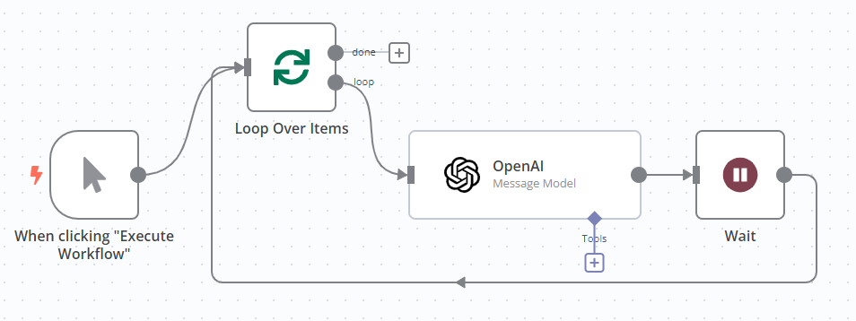

<!-- 简体中文翻译；来源 n8n-io/n8n-docs；原文版本见 upstream.json。 -->

# 处理速率限制 

API[^1] 速率限制用于限制请求频率。例如，API 可能限制每分钟或每天可发送的请求数量。

API 也可能限制单次请求可发送的数据量，或单次响应返回的数据量。

## 识别速率限制问题 

n8n 节点触发速率限制时会报错。n8n 会在节点输出面板显示错误消息，其中包括服务返回的错误消息。

如果服务向 n8n 返回 429（请求过多）错误，错误消息为 **The service is receiving too many requests from you**（该服务收到来自你的过多请求）。

要查看所用服务的速率限制，请参阅该服务的 API 文档。

## 处理集成的速率限制 

n8n 集成有两种处理速率限制的方式：使用 Retry On Fail（失败时重试）设置，或组合使用 [Loop Over Items](core-nodes/n8n-nodes-base.splitinbatches.md) 与 [Wait](core-nodes/n8n-nodes-base.wait.md) 节点：

* Retry On Fail 会在 API 请求的重试尝试之间暂停。
* Loop Over Items 配合 Wait，可以将请求数据分成较小的批次，并在请求之间暂停。

### 启用 Retry On Fail（失败时重试） 

启用 Retry On Fail 后，如果首次请求失败，节点会自动重试请求。

1. 打开节点。
2. 选择 **Settings**（设置）。
3. 开启 **Retry On Fail**（失败时重试）。
4. 配置重试设置：要避免触发速率限制，将 **Wait Between Tries (ms)**（重试间隔，毫秒）设为满足该限制的等待时长。例如，API 允许每秒一个请求时，可将 **Wait Between Tries (ms)** 设为 `1000`，等待 1 秒。

### 使用 Loop Over Items 和 Wait 

使用 Loop Over Items 节点将输入项分批，并使用 Wait 节点在每次请求之间暂停。

1. 在调用 API 的节点前添加 Loop Over Items 节点。配置方法，请参阅 [Loop Over Items](core-nodes/n8n-nodes-base.splitinbatches.md)。
2. 在调用 API 的节点后添加 Wait 节点，并将其连接回 Loop Over Items 节点。配置方法，请参阅 [Wait](core-nodes/n8n-nodes-base.wait.md)。

例如，使用 OpenAI 时，可以这样处理速率限制：

## 处理 HTTP Request 节点的速率限制 

HTTP Request 节点提供内置设置，用于处理速率限制和大量数据。

### 分批请求 

使用 Batching（分批）选项，将大量输入项分批处理，并在各批请求之间暂停，达到类似组合使用 Loop Over Items 和 Wait 的效果。分批不会把多个输入项自动合并为一个请求；每批大小与批次间隔的含义见下文。

1. 在 HTTP Request 节点中，选择 **Add Option**（添加选项）> **Batching**（分批）。
2. 设置 **Items per Batch**（每批数据项数）：每批要处理的输入项数量。
3. 设置 **Batch Interval (ms)**（批次间隔，毫秒），在各批请求之间等待。例如，API 允许每秒一个请求时，将每批大小设为一个数据项，并将 **Batch Interval (ms)** 设为 `1000`，在批次之间等待 1 秒。

### 对结果分页 

如果数据量超过单次响应可返回的范围，API 会对结果分页。HTTP Request 节点的分页功能详见 [HTTP Request 节点 | Pagination（分页）](core-nodes/n8n-nodes-base.httprequest/README.md#pagination)。

[^1]: API（应用程序编程接口）提供以编程方式访问服务数据和功能的途径，使软件更容易与外部系统交互。API 通常作为传统网页或图形用户界面的替代访问方式提供。
