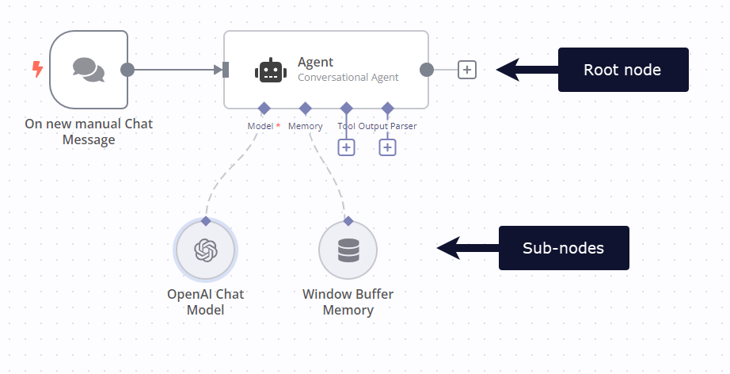

<!-- 简体中文翻译；来源 n8n-io/n8n-docs；原文版本见 upstream.json。 -->

[集群节点](../../../../../../get-started/key-concept-glossary.md#cluster-node-n8n)是相互配合、共同为 n8n 工作流提供功能的节点组。你使用一个[根节点](../../../../../../get-started/key-concept-glossary.md#root-node-n8n)和一个或多个扩展其功能的[子节点](../../../../../../get-started/key-concept-glossary.md#sub-node-n8n)来组成集群。

