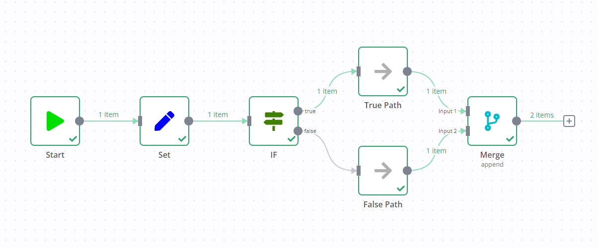

<!-- 简体中文翻译；来源 n8n-io/n8n-docs；原文版本见 upstream.json。 -->


**0.236.0 及更早版本**

n8n 在 1.0 版本移除了此执行行为。本节适用于采用 **v0 (legacy)**（v0，旧版）工作流执行顺序的工作流。默认情况下，n8n 1.0 之前构建的所有工作流均采用此顺序。可在[工作流设置](../../../../../../../build/manage-workflows/configure-workflow-settings.md)中更改执行顺序。

向包含 If 节点的工作流添加 Merge 节点，可能导致 If 节点的两个输出数据流都执行。

其中一个数据流触发 Merge 节点，随后 Merge 节点会执行另一个数据流。

例如，下图中的工作流包含 Edit Fields、If 和 Merge 节点。If 节点通常只执行一个数据流，图中为 **true**（真）输出。但由于 Merge 节点的存在，即使 If 节点没有向 **false**（假）数据流发送任何数据，两个数据流仍都会执行。

