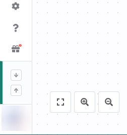
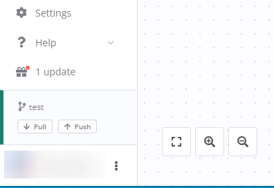

<!-- 简体中文翻译；来源 n8n-io/n8n-docs；原文版本见 upstream.json。 -->

查看截图

<figure markdown>
	
	<figcaption>菜单关闭时的拉取和推送按钮</figcaption>
</figure>

<figure markdown>
	
	<figcaption>菜单打开时的拉取和推送按钮</figcaption>
</figure>

